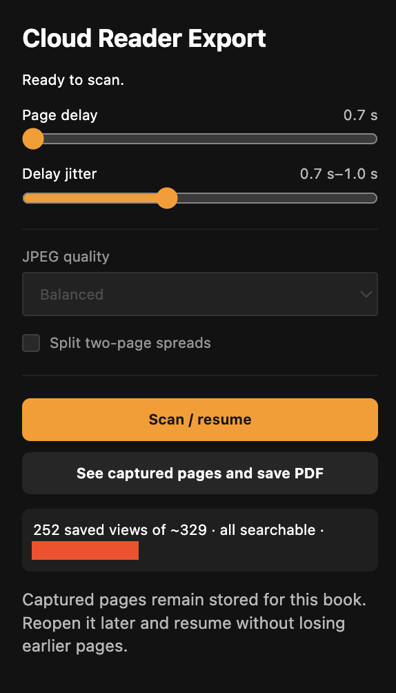
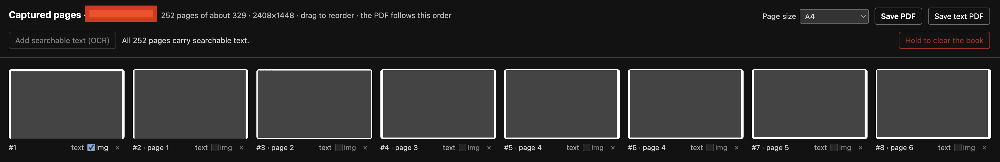

# Kindle Cloud Reader PDF Exporter

[](https://github.com/NikolaiAndreadi/kindle-cloud-reader-pdf-export/actions/workflows/ci.yaml)

A Chrome extension that exports pages already rendered by Amazon Kindle Cloud
Reader to a PDF on a real paper size, optionally with an invisible OCR text layer
so the pages are searchable and selectable.

**Use it only to make personal copies of books you own and are authorized to
copy.**



Everything runs locally in your browser. Captured pages, book identifiers, and
OCR data are never uploaded or sent to an external API or cloud AI service. It
does not download Kindle book files, decrypt content, bypass DRM, or send
telemetry. The OCR engine and English model are bundled with the extension.

## Install

No git, npm or build needed.

1. Download the `.zip` from the
   [latest release](https://github.com/NikolaiAndreadi/kindle-cloud-reader-pdf-export/releases/latest).
2. Unzip it, and move the unzipped folder somewhere you will keep it. Chrome
   loads the extension from that folder every time it starts, so deleting it uninstalls the extension.
3. Open `chrome://extensions` and turn on **Developer mode**, top right.
4. Click **Load unpacked** and select the unzipped folder itself.
5. Open a book at <https://read.amazon.com/> (regional domains such as
   `read.amazon.co.uk` and `read.amazon.com.br` work too) and click the
   extension.

**Developer mode** has to stay on: Chrome installs packaged extensions from the
Chrome Web Store and nowhere else, and this is
[not published there on purpose](CONTRIBUTING.md). Updating means downloading a
newer zip and repeating step 4.

Cloning the repository and running **Load unpacked** on the clone works exactly
the same way. The bundles and the OCR engine are checked in. This is the way to
go if you intend to change anything.

## Using it

Click the extension and choose **Scan / resume**. The same button says **Stop**
while a scan is running. Keep the reader tab visible while it scans, and if pages
come out skipped, choose the slower page delay.

The scan stops on its own at the end of the book, or when the reader stops
advancing. Captured pages are cached per book, so you can stop whenever you like
and pick up later — a page already captured is never re-encoded, and an identical
view is never stored twice.

Everything that acts on the whole book lives behind **See captured pages and save
PDF**: reordering, deleting single pages, **Page size**, **Add searchable text
(OCR)**, the two save buttons, and **Clear this book**.



**Page size** writes every page onto one real sheet — **A4**, **US Letter**, or
**Match capture** to keep whatever pixel size the reader happened to paint. The
bitmap is fitted and centred, so a page that does not match the sheet gets even
bands rather than being cropped or stretched.

In two-column mode the reader can paint a whole spread as one landscape image.
**Split two-page spreads** (on by default) cuts wide images with a clear center
gutter in two. Wide captures with content across the center stay whole.

### Searchable text

The reader paints pages as images, so there is no text to copy — the only route to
a text layer is to read the pixels back. **Add searchable text (OCR)** runs
Tesseract over the cached pages and stores the words with their positions. Reckon
on a second or two a page, so five to ten minutes for a long book. It runs in the
preview tab, which has to stay open but does not have to be the visible one, and
it is resumable: results are saved as they finish, and closing the tab costs at
most the pages in flight.

Accuracy comes from the pixels, so it is only as good as the capture. On clean
printed prose the **Balanced** image quality is enough; **High** is the first thing
to change if a book comes out badly. **Lossless** stores every page as PNG, with
no compression artefacts at all — worth it for photographs and very small print,
at several times the storage and PDF size. Like the split setting, quality is
fixed by a book's first scan. The engine is English only.

You do not need to re-scan a book captured before you decided you wanted text.

### The two exports

**Save PDF** is the scan: one image per page, with an invisible text layer over
any page OCR has read. It looks exactly like the book, whether or not you ran OCR
at all.

**Save text PDF** drops the bitmaps and sets the recognised words as real type,
placed where they were found, so headings, indents and margins keep their places.
The file comes out on the order of a hundredth the size and stays sharp at any
zoom. What it costs is everything that was not text — rules, ornaments and drop
caps do not survive, and a misread word is a misread word rather than a picture of
the right one. It needs OCR to have run first.

Plates are the exception. Every tile in the preview grid has an **img** box: tick
it and that page goes into the text PDF as the image, with the invisible words
still over the top. Pages that are mostly picture get ticked for you, as do pages
OCR failed on, which are exactly the ones to keep as bitmaps. Once you touch a
box, your answer stands and no later run overrules it.

By default, the scan downloads as `kindle-<book id>-<date>.pdf` and the text PDF
as `kindle-<book id>-text-<date>.pdf`. Enter a name in the **File name** box to
save them as `<name>.pdf` and `<name>-text.pdf`. The preview remembers it for that book.

Open **Filename builder** to set a shared template such as `{author} - {title} ({asin})`.
The builder looks up the open book in your signed-in Kindle library and previews
both download names. You can fill in missing details or override the detected
title and author per book. A per-book **File name** overrides the template.

## When it stops working

Expect it to. Kindle Cloud Reader is not a stable target and Amazon has no reason
to make it one: the class names, the footer counter, the key handling and the page
markup are all theirs to change, and a rendering path that quietly ignores a
synthetic key event costs them nothing to ship. Assume any break lands in the
direction of making it harder to keep the books you paid for, not easier, and
assume no upstream fix arrives on your schedule.

So fork it. This repo is meant to be a foundation rather than a product — the
tedious parts are the ones that are done, and they are the ones that do not depend
on Amazon's markup: the per-book cache and resume, the PDF writer that streams a
long book without holding it in memory, the invisible text layer, the paper
fitting, the unit tests. What breaks is the thin layer that reads the page and
turns it, and that is the part a coding agent can re-fit quickly if you hand it
the symptom and let it read the rest.

Start in `src/content/`. Every assumption about Amazon's markup is in `dom.ts`,
which is the whole blast radius of a reader change. A few decisions in there look
redundant and are not — trusting the page counter instead of hashing pixels, or
turning pages the obvious way — and each one is commented where it is made, with
the failure it avoids. Read those before letting an agent tidy them: they all fail
silently, by dropping pages from a scan that otherwise looks like it worked.

`npm run fixture` serves two offline pages that need no account and no book:
`test/fixture.html` has real reader markup with synthetic pages, and
`test/ocr-fixture.html` runs the OCR engine over known text. They are the fastest
way for you or an agent to tell a broken change from a broken capture.

## Build

Only needed if you change `src/`.

```sh
npm install
npm run build     # typecheck, then bundle src/ to content.js, popup.js, preview.js
npm run check     # typecheck, lint and tests
```

`npm run watch` rebuilds on change. `npm run pack` writes the release zip to
`dist/` — the files Chrome loads and nothing else; pushing a `v<version>` tag
matching `manifest.json` makes GitHub Actions build that zip and publish it as a
release. `npm run vendor` re-copies the OCR engine from
`node_modules` into `vendor/tesseract`; that directory is checked in so **Load
unpacked** works on a fresh clone, and its licenses and upstream versions are
listed in [`vendor/tesseract/THIRD_PARTY_NOTICES.md`](vendor/tesseract/THIRD_PARTY_NOTICES.md).

## Scope and limits

What the extension has access to is a rendered page in your own browser, in a book
your own account has already opened. It reads pixels off the screen — the same
pixels you are looking at — and writes them to a file.

It does not do any of the following, and there is no code here that could:

- download, request or open a Kindle book file of any kind
- decrypt anything, extract or derive a key, or interact with DRM at all
- bypass a paywall, a licence check, a lending expiry or a device limit
- give access to a book the signed-in account cannot already read
- upload captured pages or OCR text. The OCR engine is
  bundled rather than fetched. The filename builder reads library metadata
  from the signed-in reader on the same Amazon domain

So it is a screen capture tool with a page-turner and a PDF writer attached, not a
DRM tool. That distinction is the whole design, not a disclaimer.

None of that decides whether *you* may copy a particular book. Copyright in the
text is untouched by any of this, and capturing a book you do not have the right
to copy is on you. Automated capture may also conflict with Amazon's Conditions of
Use regardless of copyright; that is between you and Amazon, and using this may
put your account at risk. Nothing here is legal advice.

Not affiliated with, authorized by, or endorsed by Amazon. "Amazon", "Kindle" and
"Kindle Cloud Reader" are trademarks of Amazon.com, Inc. or its affiliates, used
here only to say which website this software works with.

## Contributing

Bug fixes are welcome. New features are out of scope for this repo — if you want
it to do something else, fork it; that is what it is for. See
[CONTRIBUTING.md](CONTRIBUTING.md).

## License

[MIT](LICENSE) © Nikolai Andreadi.

The Tesseract OCR engine and English model in `vendor/tesseract` are third-party
code under the Apache License 2.0 and keep their own terms.
